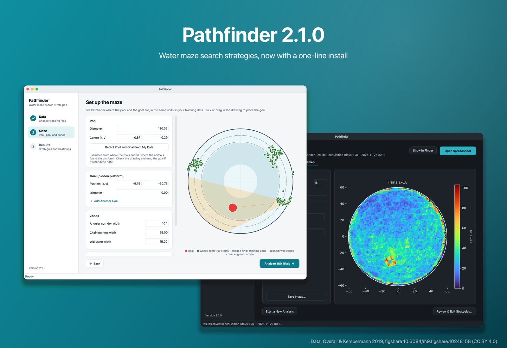
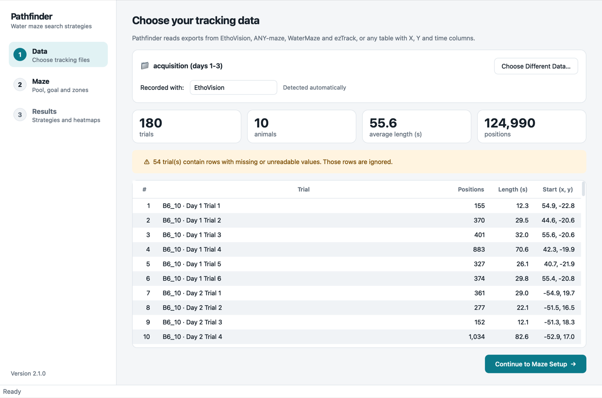
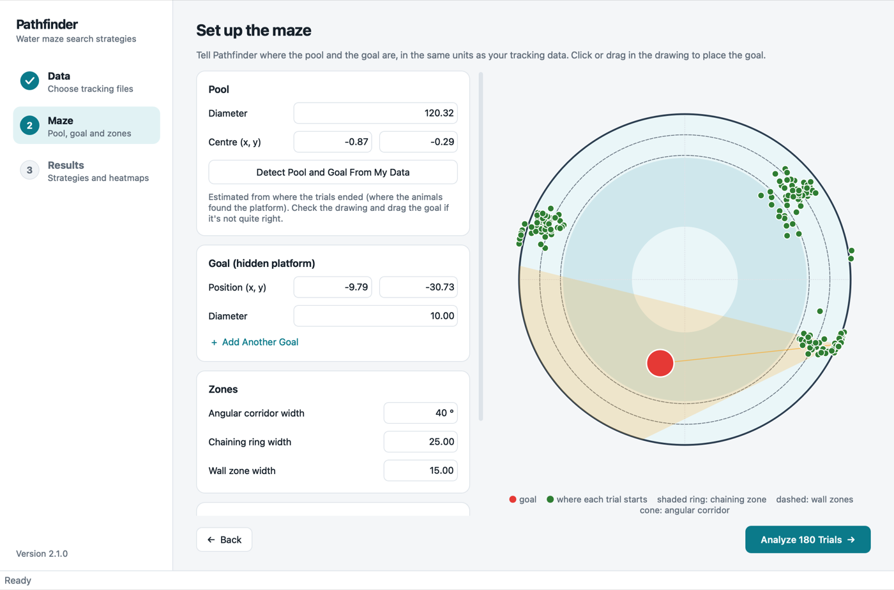
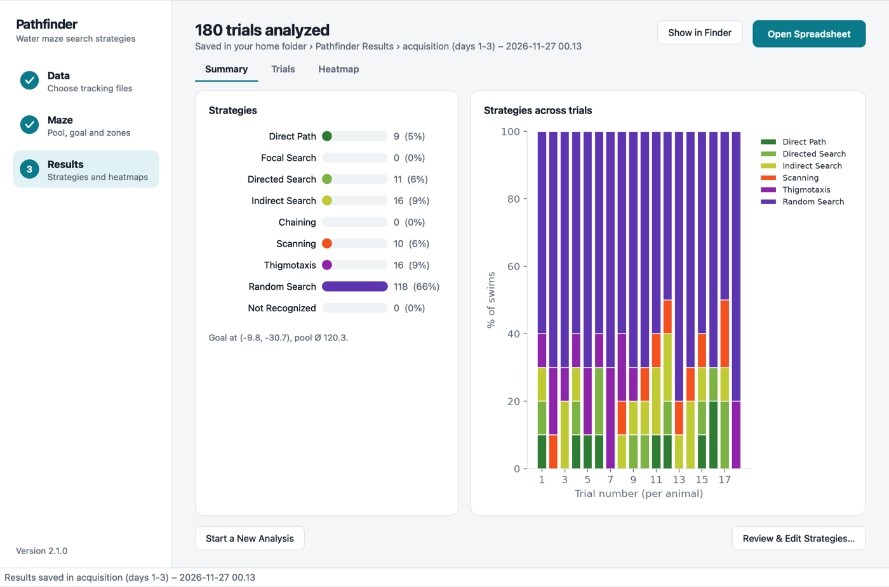
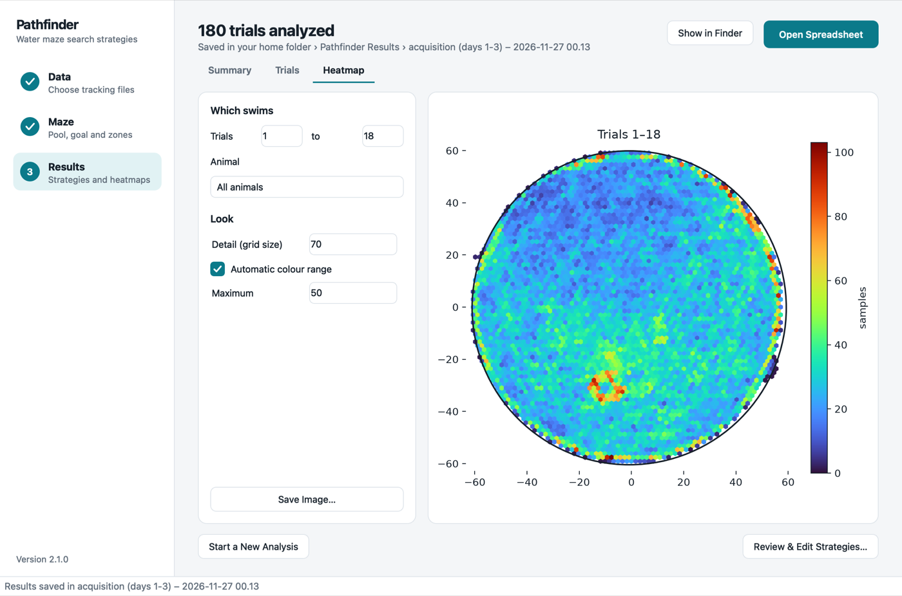
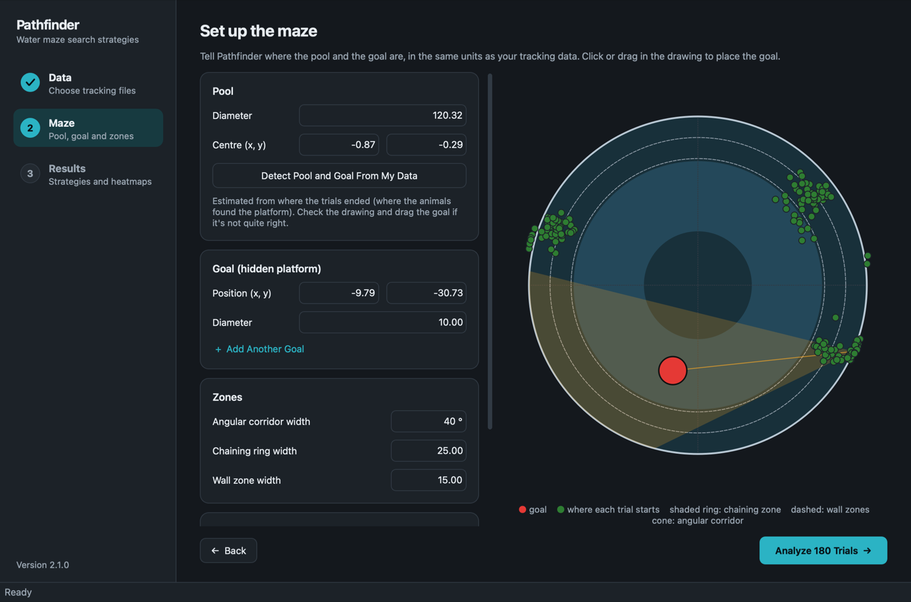

# Pathfinder

Search-strategy analysis for the Morris Water Maze. Load your tracking data, set your pool and goal, and Pathfinder sorts every trial into Direct Swim, Directed Search, Focal Search, Spatial Indirect, Chaining, Scanning, Thigmotaxis or Random Search. It also draws occupancy heatmaps.

This is a modernized fork of [MatthewBCooke/Pathfinder](https://github.com/MatthewBCooke/Pathfinder) by **Matthew Cooke** (Jason Snyder Lab, University of British Columbia). It has a new interface, a one-command install and bug fixes. The strategy analysis gives the same results as the original: this is checked by tests against the original program's output. It is also checked on 300 real mouse swims (Overall & Kempermann 2019, [figshare](https://doi.org/10.6084/m9.figshare.10248158.v3)): every strategy and measure matches the original exactly.



## Install

### Mac

Open **Terminal** (press ⌘ Space, type `Terminal`, press Return), paste this line and press Return:

```bash
curl -LsSf https://raw.githubusercontent.com/Zaf4/Pathfinder/master/install.sh | sh
```

That's it. It takes a minute or two the first time. Pathfinder then opens by itself, and you'll find it in your **Applications** folder, Launchpad and Spotlight like any other app.

- No administrator password, Homebrew, conda, git or Xcode needed, and no "unidentified developer" or "install developer tools" pop-ups. Everything goes into your home folder.
- Works on macOS 11 or newer (Apple Silicon and Intel). The same command works on Linux.

### Windows

Press **Windows key + R**, paste this line and press Enter:

```powershell
powershell -ExecutionPolicy ByPass -c "irm https://raw.githubusercontent.com/Zaf4/Pathfinder/master/install.ps1 | iex"
```

A blue window shows the progress, and Pathfinder opens by itself when it's done. It's in the **Start menu** and on your **desktop**. No administrator rights, Python, conda or git needed. Works on Windows 10 and 11.

### Updating and uninstalling

To update, use **Help → Check for Updates** in the app, or run the install command again.

To uninstall on a Mac:

```bash
curl -LsSf https://raw.githubusercontent.com/Zaf4/Pathfinder/master/uninstall.sh | sh
```

On Windows, go to **Settings → Apps**, find **Pathfinder** and click **Uninstall**. Either way, your results are kept.

<details>
<summary>Already use uv?</summary>

```bash
uv tool install "jsl-pathfinder @ https://github.com/Zaf4/Pathfinder/archive/refs/heads/master.zip"
pathfinder
```
</details>

## How to use it

1. **Data**: drag a folder of trials onto the window, or click **Choose Folder…**. Pathfinder recognizes EthoVision (`.xlsx`), ANY-maze, WaterMaze and ezTrack (`.csv`) exports by itself. For any other table, choose **Custom columns** under *Recorded with* and click the X, Y and time columns.
   
2. **Maze**: click **Detect Pool and Goal From My Data**, or type the values. Pathfinder finds the platform from where the trials ended. You can also drag the goal on the pool picture. The amber band shows the corridor used for "directed" strategies, and the ring shows the chaining zone. Add extra goals if your experiment had a reversal.
   
3. **Analyze**: you get a summary, a per-trial table with the swim path of each trial, and heatmaps you can filter by trial, day or animal.
   
   

Results go to a **Pathfinder Results** folder in your home folder, one folder per run: `Pathfinder Results/<experiment> – <date time>/`. The **Show in Finder** / **Show in Explorer** button takes you there.

| File | What it is |
|---|---|
| `strategies.csv` | One row per trial: strategy, score and all measures (same columns as the original Pathfinder) |
| `strategies - Goal N (x, y).csv` | The same for each extra goal |
| `settings used.json` | The maze setup and thresholds used for this run |

**Review strategies**: you can check trials by hand (keys `1`–`9`, `0`), either during the analysis (*Options → Review trials by hand*) or afterwards (**Review & Edit Strategies…** or double-click a trial). Your choice is saved in the spreadsheet next to the automatic one.

**Thresholds**: the defaults are the published ones. You can change them under **Pathfinder → Settings…** (⌘,), or with the **Edit…** button on the Maze step. The parameters are described in the [original wiki](https://github.com/MatthewBCooke/Pathfinder/wiki/Description-of-Parameters).

Light and dark mode follow your system setting.



<sub>Screenshots show real mouse data: Overall & Kempermann (2019), [figshare](https://doi.org/10.6084/m9.figshare.10248158.v3), CC BY 4.0.</sub>

## What changed from the original

- New Qt (PySide6) interface in three steps: Data → Maze → Results. It doesn't freeze during analysis, and you can cancel.
- One-command installer that creates a real macOS app. No more broken Tk, conda or pip.
- Bugs fixed:
  - Software auto-detection.
  - Watermaze output columns were shifted.
  - Settings and output files were written to whatever folder you launched from.
  - The Calculate button was enabled even after cancelling the file dialog.
  - Menu items were mislabeled, and Update via pip was broken.
  - The heatmap day filter was ignored.
  - The start marker was drawn at a fixed position.
  - The ROI list duplicated itself when reopened.
  - Number fields changed when you scrolled over them.
- Not included (yet): the optional entropy calculation, which needs MATLAB/Octave.

## Citing

If you use Pathfinder, please cite the original paper:

> Cooke MB, O'Leary TP, Harris P et al. (2019) Pathfinder: open source software for analyzing spatial navigation search strategies. *F1000Research*, 8:1521. https://doi.org/10.12688/f1000research.20352.2

The same citation is under **Help → How to Cite** in the app.

## Development

```bash
git clone https://github.com/Zaf4/Pathfinder && cd Pathfinder
uv run pathfinder          # run from source
uv run pytest              # golden tests vs. the original + GUI tests
uv run python tools/screenshots.py /tmp/shots   # render every screen, light + dark
```

The layout:

- `src/pathfinder/core`: readers, geometry and classification. No GUI code.
- `src/pathfinder/gui`: the Qt app.
- `tests/golden`: reference output recorded from the original program.

## License

GPL-3.0, like the original. See [LICENSE](LICENSE).
